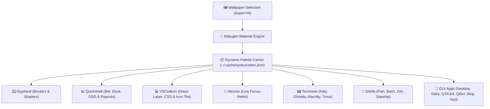

<div align="center">

# 🌸 Lily Desktop Rice & Dotfiles

### A cohesive, wallpaper-reactive Arch Linux desktop environment powered by Hyprland, Quickshell, and Matugen.

<p align="center">
  
  
  
  
  
  
  
  
</p>

> *"Lily is the affectionate name I have given to my laptop — a daily companion tailored from the ground up for focused development, fluid animations, and a calm, wallpaper-reactive aesthetic."*

</div>

---

## 📖 Table of Contents

1. [Meet "Lily"](#-meet-lily)
2. [Features & Design Philosophy](#-features--design-philosophy)
3. [Architecture & Theming Pipeline](#-architecture--theming-pipeline)
4. [Riced Applications Breakdown](#-riced-applications-breakdown)
5. [Keybindings Cheat-Sheet](#-keybindings-cheat-sheet)
6. [Installation & Deployment](#-installation--deployment)
7. [Repository Structure](#-repository-structure)
8. [GitHub Upload Instructions](#-github-upload-instructions)

---

## 💻 Meet "Lily"

> *"Lily"* is the personal name I gave to my laptop — a trusty companion customized from the ground up to be my dream workstation. 
>
> Despite having modest specs, Lily runs exceptionally light, fluid, and responsive. Every script, animation bezier curve, glass blur effect, and dynamic color rule in this repository was hand-tuned to ensure a whisper-quiet, battery-friendly, and distraction-free environment that automatically reactive-tints itself to whatever mood or wallpaper is set.

### ⚙️ Machine Vitals & Specs
- **Device Name**: Lily
- **OS**: Arch Linux (rolling release)
- **Compositor**: Hyprland (Wayland with native modular Lua configuration)
- **Desktop Shell**: Quickshell (single resident QML runtime for bar, dock, and popouts)
- **CPU**: Intel® Core™ i3-6006U (4 threads @ 2.00 GHz)
- **GPU**: Intel® HD Graphics 520 (Integrated Vulkan / OpenGL)
- **RAM**: 4 GB (tuned swappiness and zram/caching)
- **Filesystem**: Btrfs with Snapper automatic snapshot protection
- **Primary Shell**: Fish + Starship (`mythos` pill layout)
- **Editors**: Translucent VSCodium (custom glass CSS) & Neovim (LazyVim with live palette sync)

---

## ✨ Features & Design Philosophy

- **Dynamic Material You Theming**: Switching wallpapers automatically extracts an accent palette via **Matugen**, instantaneously retinting the entire desktop, terminals, editors, chat clients, and system monitors without reboots.
- **Single-Engine Desktop Shell**: Powered by **Quickshell** (Qt6/QML) for ultra-low latency rendering, unifying the status bar, app launcher, notification daemon, clipboard manager, audio popouts, and OSD in one resident process.
- **Lua-Native Compositor**: Hyprland configuration authored in clean, modular Lua with custom `lilyBloom` and `lilySettle` bezier curves, active window shaders, and dynamic display scaling.
- **Glass VSCodium Rice**: Translucent editor over the desktop wallpaper, featuring Space Grotesk chrome, JetBrains Mono ligatures, a custom Material Icon Theme fork, Vim keybindings, and automatic restart prompts on wallpaper change.
- **Dynamic Neovim**: TokyoNight theme dynamically retints upon focus gain, paired with a custom `LILY` ASCII startup dashboard and LazyVim plugin architecture.
- **Multi-Shell Parity**: Consistent prompt styling, fzf palette, syntax highlighting, and eza aliases across **Fish**, **Bash**, and **Zsh**.

---

## 🎨 Architecture & Theming Pipeline



---

## 📋 Riced Applications Breakdown

| Category | Application | Config Location | Key Customizations |
|---|---|---|---|
| **Compositor** | **Hyprland** | [`.config/hypr/`](.config/hypr/) | Full Lua stack, `lilyBloom` / `lilySettle` curves, GLSL shaders (`grain.glsl`, `vignette.glsl`), window rules |
| **Shell & Bar** | **Quickshell** | [`.config/quickshell/`](.config/quickshell/) | Single resident QML shell, Ricelin bar, dock, QuickSettings, volume/audio popouts, launcher |
| **Code Editor** | **VSCodium** | [`.config/VSCodium/`](.config/VSCodium/) | Translucent glass UI, Space Grotesk UI, JetBrains Mono font, static Material Icon fork, Vim mode |
| **Text Editor** | **Neovim** | [`.config/nvim/`](.config/nvim/) | LazyVim, dynamic TokyoNight palette sync, custom ASCII `LILY` startup banner (`snacks.nvim`) |
| **Code Editor** | **Zed** | [`.config/zed/`](.config/zed/) | Dynamic Matugen JSON theme (`themes/matugen.json`) |
| **Terminal Editor** | **Micro** | [`.config/micro/`](.config/micro/) | Matugen Material colorscheme (`colorschemes/matugen.micro`) |
| **Terminal** | **Kitty** | [`.config/kitty/`](.config/kitty/) | Custom fonts, blur, padding, Matugen palette include (`current-theme.conf`) |
| **Terminal** | **Ghostty** | [`.config/ghostty/`](.config/ghostty/) | Minimal padding, typography, wallpaper palette include (`lily-colors`) |
| **Terminal** | **Alacritty** | [`.config/alacritty/`](.config/alacritty/) | Matugen color palette (`colors.toml`) |
| **Multiplexer** | **Tmux** | [`.tmux.conf`](.tmux.conf) | Custom window splits (`\|`, `-`), status bar palette mapped to wallpaper |
| **Shell** | **Fish** | [`.config/fish/`](.config/fish/) | Starship prompt, zoxide, mise, fzf colors, eza aliases, `conf.d/lily-colors.fish` |
| **Prompt** | **Starship** | [`.config/starship.toml`](.config/starship.toml) | Custom "Mythos" dark palette with pill-shaped Nerd Font caps (``, ``) |
| **Shells** | **Bash & Zsh** | [`.config/bash/`](.config/bash/) / [`.config/zsh/`](.config/zsh/) | ble.sh and zsh-syntax-highlighting themes, eza integration, fastfetch greeting |
| **System Monitor**| **Btop** | [`.config/btop/`](.config/btop/) | `btop.conf` using Matugen palette (`themes/lily.theme`) |
| **Audio Visualizer**| **Cava** | [`.config/cava/`](.config/cava/) | Spectrum settings, custom themes, GLSL fragment shaders (`bar_spectrum`, `eye_of_phi`) |
| **System Info** | **Fastfetch** | [`.config/fastfetch/`](.config/fastfetch/) | Custom JSONC config with Lily brand emblem and system vitals |
| **File Manager** | **Yazi** | [`.config/yazi/`](.config/yazi/) | Terminal file manager with custom theme (`theme.toml`) and Neovim openers |
| **Chat / Discord**| **Vesktop & Equibop** | [`.config/vesktop/`](.config/vesktop/) | Midnight Discord theme recolored via Matugen CSS |
| **Music Client** | **Sidra (Cider)** | [`.config/Sidra/`](.config/Sidra/) | 10KB+ Material You custom glass stylesheet (`custom.css`) |
| **Streaming** | **OBS Studio** | [`.config/obs-studio/`](.config/obs-studio/) | Matugen dark theme (`themes/matugen.theme`) |
| **Document Reader**| **Zathura** | [`.config/zathura/`](.config/zathura/) | Matugen color palette (`zathurarc`) |
| **GUI Toolkits** | **GTK 3 & GTK 4** | [`.config/gtk-3.0/`](.config/gtk-3.0/) / [`.config/gtk-4.0/`](.config/gtk-4.0/) | Libadwaita / GTK CSS with auto-recolored accent palettes |
| **Qt Theming** | **Qt6ct** | [`.config/qt6ct/`](.config/qt6ct/) | Qt6 color scheme and font settings (`colors/lily.conf`) |
| **Theming Engine**| **Matugen** | [`.config/matugen/`](.config/matugen/) | 28 templates fanning colors out to all desktop surfaces |
| **Wallpapers** | **Wallpapers** | [`wallpapers/`](wallpapers/) | Curated desktop wallpapers used in the rice |

---

## ⌨️ Keybindings Cheat-Sheet

The `SUPER` key is the primary modifier:

### Applications & Launchers
| Shortcut | Action |
|---|---|
| `SUPER + Return` | Launch Terminal (Ghostty / Kitty) |
| `SUPER + Space` | Open App Launcher |
| `SUPER + E` | Open File Manager (GUI) |
| `SUPER + ALT + E` | Open Terminal File Manager (Yazi) |
| `SUPER + B` | Launch Web Browser |
| `SUPER + N` | Launch Text Editor (Neovim) |
| `SUPER + K` | Toggle Keybindings Cheatsheet |
| `SUPER + ,` | Open Desktop Settings Control Center |

### Window Management
| Shortcut | Action |
|---|---|
| `SUPER + Q` | Close active window |
| `SUPER + F` | Toggle Fullscreen |
| `SUPER + D` | Maximize window |
| `SUPER + A` | Toggle Float & Center (1000x660 default) |
| `SUPER + R` | Enter Interactive Resize Mode (`hjkl` / arrows to resize, `Esc` exits) |
| `SUPER + Left / Right / Up / Down` | Move window focus |
| `SUPER + SHIFT + Left / Right / Up / Down` | Move window position |
| `SUPER + CTRL + Left / Right / Up / Down` | Step window dimensions |

### Desktop & Shell Utilities
| Shortcut | Action |
|---|---|
| `SUPER + W` | Open Wallpaper Picker UI |
| `SUPER + SHIFT + W` | Pick Random Wallpaper & Transition |
| `SUPER + Tab` | Workspace Overview / Expo (Live previews) |
| `SUPER + V` | Open Clipboard History |
| `SUPER + M` | Toggle Desktop Audio Visualizer |
| `SUPER + SHIFT + S` | Screenshot & Annotation Tool |
| `SUPER + SHIFT + C` | Color Picker (Hex copy to clipboard) |
| `SUPER + L` | Lock Screen |
| `SUPER + Escape` | Quick Settings (Power, Wi-Fi, Session logout) |

---

## 📦 Installation & Deployment

### Quick Install (Automated)

Clone the repository and run the provided deployment script:

```bash
git clone https://github.com/ascended-parth/dotfiles.git ~/dotfiles
cd ~/dotfiles
chmod +x install.sh
./install.sh
```

> [!NOTE]
> The `install.sh` script automatically backs up any existing configuration files into `~/.dotfiles_backup_<timestamp>/` before deploying.

---

## 📁 Repository Structure

```text
dotfiles/
├── .config/
│   ├── alacritty/               # Terminal configuration & colors
│   ├── bash/                    # Bash profile, completions, and rashin scripts
│   ├── btop/                    # System monitor config & lily palette
│   ├── cava/                    # Audio visualizer spectrum & GLSL shaders
│   ├── environment.d/           # Wayland & Qt environment session overrides
│   ├── equibop/                 # Discord client Matugen theme
│   ├── fastfetch/               # Neofetch replacement with Lily branding
│   ├── fish/                    # Fish shell configurations & color definitions
│   ├── ghostty/                 # Modern GPU terminal styling
│   ├── gtk-3.0/ & gtk-4.0/      # Libadwaita & GTK theme overrides
│   ├── hypr/                    # Modular Lua Hyprland configurations & scripts
│   ├── kitty/                   # Kitty terminal config, fonts, and theme includes
│   ├── matugen/                 # Matugen master config & 28 templates
│   ├── micro/                   # Micro terminal editor colorscheme
│   ├── nvim/                    # LazyVim setup with ASCII dashboard & dynamic tint
│   ├── obs-studio/              # OBS Studio dark theme
│   ├── qt6ct/                   # Qt6 configuration & lily color scheme
│   ├── quickshell/              # Single resident QML desktop shell runtime
│   ├── Sidra/                   # Cider/Sidra Material You stylesheet
│   ├── tmux/                    # Tmux color profile matching wallpaper
│   ├── vesktop/                 # Discord client custom CSS
│   ├── voxtype/                 # Dictation & voice typing configuration
│   ├── VSCodium/                # Glass rice stylesheet, custom font & settings
│   ├── wireplumber/             # Bluetooth audio & codec preferences
│   ├── yazi/                    # Yazi terminal file manager theme & openers
│   ├── zathura/                 # PDF & document viewer palette
│   ├── zed/                     # Zed editor Matugen theme
│   ├── zsh/                     # Zsh configuration & plugins
│   ├── starship.toml            # Mythos pill prompt configuration
│   └── chrome-flags.conf        # Native Wayland flags for Chromium
├── .local/
│   └── bin/
│       ├── vscodium-rice        # VSCodium launcher wrapper
│       ├── lily-vscodium-sync   # Palette downsampler & CSS regenerator
│       └── lily-vscodium-restart# Graceful VSCodium restart helper
├── .vscode-oss/
│   └── extensions/
│       └── lily.lily-vscodium-theme-1.0.0/ # Custom VS Code theme & watcher extension
├── wallpapers/                  # Curated desktop wallpapers
├── .bash_profile
├── .bashrc
├── .tmux.conf
├── .gitignore                   # Excludes locks, logs, sockets, and sensitive files
├── install.sh                   # Automated deployment & backup script
└── README.md                    # This document
```

  Crafted with care for <b>Arch Linux</b> · Built with <b>Hyprland</b> & <b>Quickshell</b>
</div>
